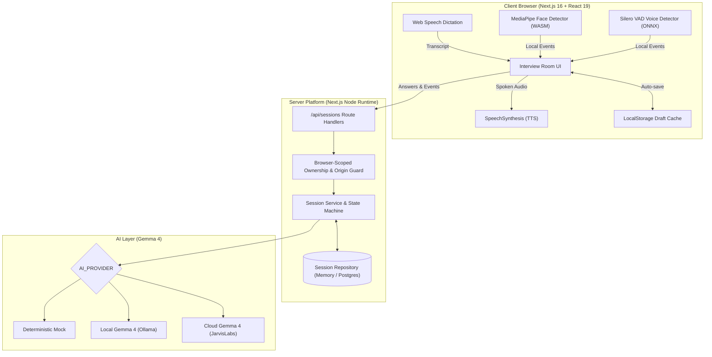

# InterviewIQ

> **Intelligent, adaptive technical mock interview platform powered by Gemma 4 with private client-side monitoring.**

[](https://nodejs.org/)
[](https://nextjs.org/)
[](https://react.dev/)
[](https://www.typescriptlang.org/)
[](https://vitest.dev/)
[](https://tailwindcss.com/)

---

## 🌟 Overview

**InterviewIQ** is an open-source technical interview prep platform built for realistic, adaptive technical practice. Unlike standard question-and-answer tools, InterviewIQ dynamically probes candidate answers with **context-aware follow-ups**, enforces **verbatim quote-grounded feedback**, and conducts **100% on-device monitoring** without compromising user privacy.

---

## ✨ Key Features

### 🎙️ 1. Voice-Driven Interview Experience

- **Editable Speech Dictation:** Speak your responses naturally using the Web Speech API, with real-time editable transcripts before final submission.
- **Spoken Questions:** Natural Text-to-Speech (TTS) plays interview questions aloud, intelligently coordinating with audio analysis.
- **Draft Resilience:** In-progress answers automatically persist to `localStorage` and recover upon accidental tab reload.
- **Hardware Preflight & Explicit Consent:** Validates microphone and webcam availability with clear permission gates before any session begins.

### 🧠 2. Gemma 4 Intelligence & Adaptive Questioning

- **Dynamic Follow-Ups:** Listens to candidate answers and introduces relevant architectural edge cases, changed constraints, and trade-offs.
- **Evidence-Grounded Rubric:** Scoring across 4 dimensions (_Technical Correctness, Communication, System Design, Edge-Case Handling_).
- **Strict Verbatim Quoting:** Every critique, gap, and strength quotes candidate statements verbatim to eliminate AI hallucination.
- **Flexible AI Backends:**
  - **Offline Deterministic Mock:** Instant feedback with zero API keys or external dependencies.
  - **Local Gemma 4 (Ollama):** Completely private local inference on your own hardware.
  - **Cloud Gemma 4 (JarvisLabs):** High-performance cloud LLM deployment with structured JSON parsing.

### 👁️ 3. Private Client-Side Monitoring

- **100% On-Device Inference:** Real-time face presence via MediaPipe Vision and speech activity via Silero VAD (ONNX WASM) running directly in the browser.
- **Zero Video/Audio Streaming:** No media streams or webcam feeds ever leave your machine or upload to external servers.
- **Focus & Presence Tracking:** Transparently records tab visibility changes and presence interruptions.
- **Strict Ethical Boundary:** Proctored session observations stay strictly separate from technical scores and do not penalize technical evaluations.

### 🛡️ 4. Enterprise Platform & Persistence

- **Browser-Scoped Ownership:** Secure SHA-256 cookie session isolation with strict Origin verification.
- **Targeted Practice Rounds:** Completed interviews can instantly spawn focused retry rounds targeting specific identified weaknesses while preserving the original job description.
- **Export & Reports:** Detailed performance breakdowns with native print/PDF formatting and full JSON data export.
- **Dual Storage Engines:** Zero-config in-memory storage for development, with production-ready PostgreSQL persistence and Temporal workflow workers.

---

## 🏗️ System Architecture



---

## 🚀 Quickstart

### Prerequisites

- **Node.js**: `v24.x` (Recommended)
- **npm**: `v10.x+`

### 1. Installation

```bash
# Clone the repository
git clone https://github.com/mansikardile/AI-Interview.git
cd AI-Interview

# Install dependencies (automatically prepares VAD & MediaPipe assets)
npm install

# Setup environment variables
cp .env.example .env.local
# (On Windows PowerShell: Copy-Item .env.example .env.local)
```

### 2. Start the Development Server

```bash
npm run dev
```

Open [http://localhost:3000](http://localhost:3000) in your browser.

> **Note:** By default, InterviewIQ runs in **Mock AI mode** with **In-Memory storage**. You can test the complete interview lifecycle without setting up any API keys or databases!

---

## 🧪 Testing and Inspection Links

| Destination           | URL                                                                            | Description                                                             |
| --------------------- | ------------------------------------------------------------------------------ | ----------------------------------------------------------------------- |
| **Home / Setup**      | [`http://localhost:3000`](http://localhost:3000)                               | Configure role, seniority level, question count, and paste a custom JD. |
| **Instant Demo Room** | [`http://localhost:3000/interview/demo`](http://localhost:3000/interview/demo) | Test voice controls and Q&A UI directly with preloaded fixtures.        |
| **Monitoring Lab**    | [`http://localhost:3000/monitoring`](http://localhost:3000/monitoring)         | Test client-side MediaPipe and VAD detection with test inputs.          |
| **System Health API** | [`http://localhost:3000/api/health`](http://localhost:3000/api/health)         | Check active AI provider, storage backend, and engine readiness.        |

---

## 🤖 Configuring Gemma 4 Backends

InterviewIQ supports three intelligence modes configured via `.env.local`:

### Option A: Deterministic Mock (Default)

```dotenv
AI_PROVIDER=mock
```

_Zero setup. Returns instant, reproducible evaluations and follow-ups._

### Option B: Local Gemma 4 via Ollama

```dotenv
AI_PROVIDER=ollama
OLLAMA_MODEL=gemma4:e2b-mlx
OLLAMA_BASE_URL=http://127.0.0.1:11434/v1
```

_Runs completely offline on your workstation. Run `npm run test:ollama` to verify._

### Option C: Cloud Gemma 4 via JarvisLabs

```dotenv
AI_PROVIDER=jarvis
JARVISLABS_API_KEY=your_jarvislabs_key
JARVISLABS_BASE_URL=https://models.jarvislabs.net/v1
JARVISLABS_MODEL=gemma-4-31b-it
```

_Hosted cloud inference with high concurrency. Run `npm run test:jarvis` to verify._

---

## 🛠️ Available Scripts

| Command                          | Description                                                          |
| -------------------------------- | -------------------------------------------------------------------- |
| `npm run dev`                    | Starts the Next.js development server with Webpack.                  |
| `npm run check`                  | Runs full suite: ESLint, TypeScript types, and all 93 unit tests.    |
| `npm test`                       | Runs the Vitest test runner.                                         |
| `npm run test:watch`             | Starts Vitest in interactive watch mode.                             |
| `npm run test:smoke`             | Executes HTTP API lifecycle test against a live dev server.          |
| `npm run test:integration:smoke` | Runs end-to-end simulated 3-round interview smoke flow.              |
| `npm run test:ai`                | Runs prompt boundary, rubric schema, and quote-grounding tests.      |
| `npm run test:jarvis`            | Runs live hosted Gemma 4 calls using JarvisLabs serverless endpoint. |
| `npm run test:monitoring`        | Runs detector, event queue, and VAD unit test suite.                 |
| `npm run test:ollama`            | Verifies live connectivity with local Ollama Gemma 4 model.          |
| `npm run build`                  | Builds the production bundle.                                        |
| `npm run format`                 | Formats the codebase using Prettier.                                 |
| `npm run db:migrate`             | Runs PostgreSQL migrations (if using persistent database).           |
| `npm run worker:dev`             | Runs background Temporal worker for session workflows.               |
| `npm run temporal:smoke`         | Runs Temporal worker connectivity smoke test.                        |

---

## 👥 Team & Architecture Map

InterviewIQ was built across four core domains:

| Owner | Responsibility                                                                               | Core Directory              | Spec Reference                                     |
| :---: | -------------------------------------------------------------------------------------------- | --------------------------- | -------------------------------------------------- |
| **A** | **Interview Experience**<br>Voice UI, speech synthesis, dictation, draft recovery, preflight | `src/modules/interview/`    | [001 Spec](specs/001-interview-experience/spec.md) |
| **B** | **Intelligence & Prompts**<br>Gemma 4 integration, adaptive follow-ups, quote validation     | `src/modules/intelligence/` | [002 Spec](specs/002-intelligence/spec.md)         |
| **C** | **Private Monitoring**<br>MediaPipe face detection, Silero VAD, camera/mic lifecycle         | `src/modules/monitoring/`   | [003 Spec](specs/003-monitoring/spec.md)           |
| **D** | **Platform & Services**<br>Session API, persistence, security, report PDF/JSON, retry rounds | `src/modules/platform/`     | [004 Spec](specs/004-platform/spec.md)             |

---

## 🔒 Privacy & Ethical Design

1. **Local Media Only:** Audio and video streams are processed exclusively in client-side WebAssembly. No media files or raw streams are ever transmitted to any server.
2. **Evaluation Decoupling:** Monitoring events (e.g., looking away or speaking pauses) are classified as _session observations_ and are strictly separated from technical rubric scoring.
3. **Candidate Ownership:** Interview sessions can be deleted on-demand with confirmed browser-scoped deletion.
4. **Transparent Attestation:** System capabilities and active AI providers are clearly labeled at every stage of the session.

---

## 📄 License

This project is licensed under the MIT License — see the [LICENSE](LICENSE) file for details.
