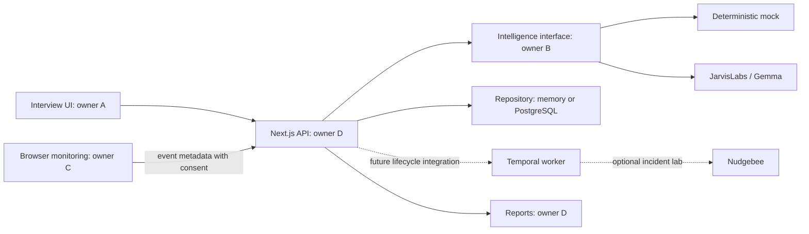

# Architecture and integration boundaries

## Decisions

- Next.js App Router, TypeScript, Tailwind/PostCSS and ESLint; npm lockfile committed for reproducibility. Development/build scripts explicitly use the supported Webpack path because the starter's Turbopack loader required a compiler port unavailable in the initialization environment.
- A modular monolith: four independently owned feature areas in one app. Route handlers are thin adapters to platform services.
- Zod validates network and model boundaries. Browser consumers use the same contract types.
- Default runtime is a labeled local demo: mock intelligence, memory repository, no external credentials.
- PostgreSQL adapter and migration provide optional durable session storage. The anonymous browser owner cookie scopes all session operations.
- Temporal runs as a separate Node worker. The initial workflow is a smoke-test foundation; it does not yet orchestrate HTTP session progression.
- Camera/audio are required for saved interview UI progression, with explicit consent and revocable browser permission. Fixtures/lab remain optional. Detection runs in the browser; only event metadata leaves it, never frames or raw audio.
- Nudgebee is an optional server-side adapter for an SRE practice lab. It is not in the critical interview path and has no pretend default deployment.

## Flow

## Files

`src/contracts` contains runtime schemas and shared domain types. `src/fixtures` contains predictable answers/sessions. `src/modules/*/index.ts` is each module's public surface. `src/lib/api-client.ts` is the browser's typed HTTP wrapper. `src/workers/temporal` contains the independent worker and workflow example. `infra` / `scripts` contain optional infrastructure and migration tooling.

## Session lifecycle

`in_progress -> completed`. A session begins with one question. An accepted answer receives feedback and either a new question or completion after the configured number of questions. A follow-up counts toward that limit. The report is available only for a completed session. Pause, cancellation and timeout states are specified as future work rather than half-implemented enum values.

Answer submissions carry a client-generated UUID. Duplicate submission IDs return the existing state; reuse with different content is rejected. A submitted `questionId` must match the current question. Mutations use a revision/CAS check so overlapping requests cannot silently overwrite answers/events.

## Storage and deployment limits

Memory mode is process-local, disappears on restart, and is not suitable for multi-instance/serverless deployment. PostgreSQL uses a JSONB session aggregate behind the same repository contract; this intentionally keeps an MVP small while leaving a normalization path. Requests require ownership; unauthorized IDs return 404 to avoid disclosing session existence.

Do not advertise crash-safe sessions until PostgreSQL is enabled and the Temporal lifecycle integration is complete. A Temporal example alone is not end-to-end durability. Run the worker on a long-lived Node process, never inside a Next.js request or Edge runtime.

## Audio and vision

Face detection runs separately from interview intelligence. No gaze/emotion/identity analysis. Browser-local MediaPipe detects faces at four frames/second with quality guards and sustained-condition grace periods; local Silero VAD reports speech/silence, not speaker identity. Text input is always available. Team C implements consent controls, device lifecycle, model preparation, a bounded retry queue and export; transcription remains assigned to A. See `docs/TEAM-C-HANDOFF.md` for actual device-testing limits and public interfaces.

For the model, the initial live adapter sends text via Chat Completions. It validates output and quote evidence. Image/audio support of the hosted endpoint must be checked before adding whiteboard or native audio features.
